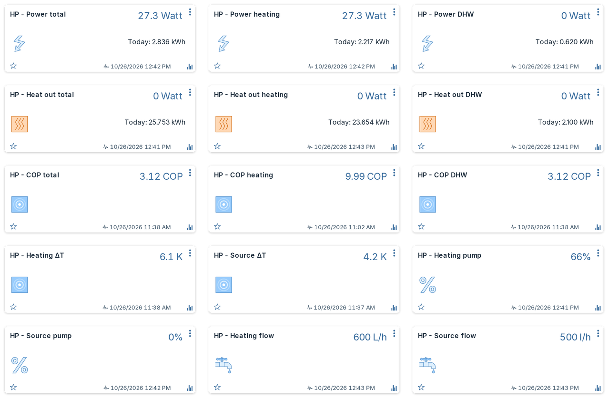
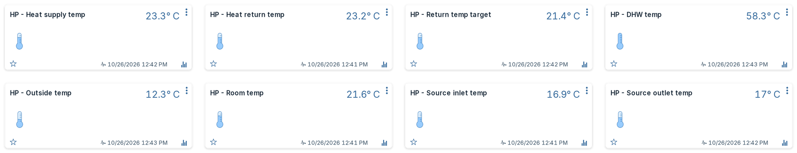
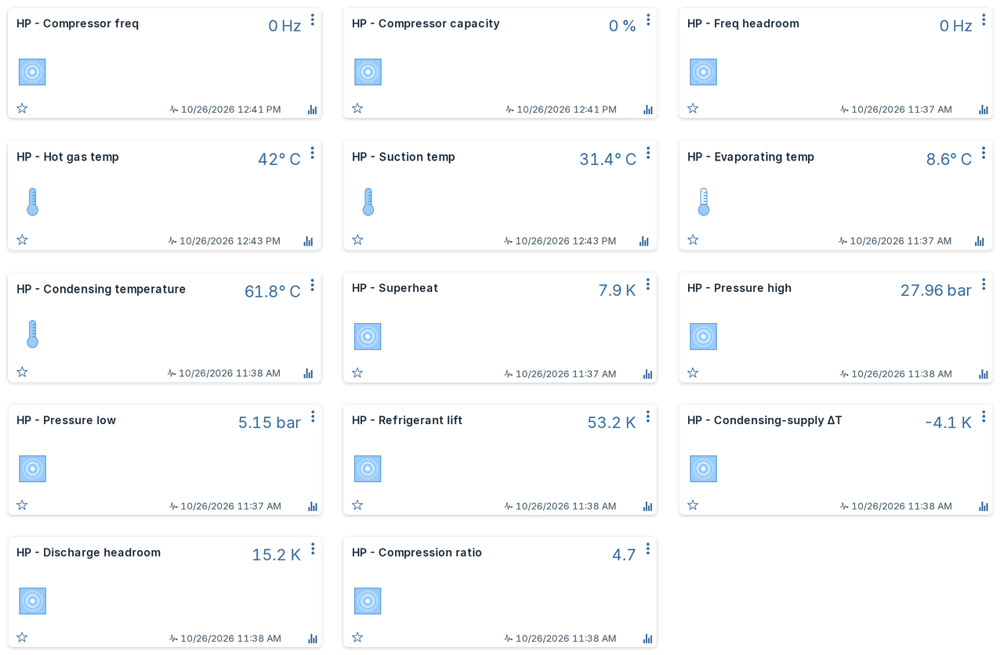
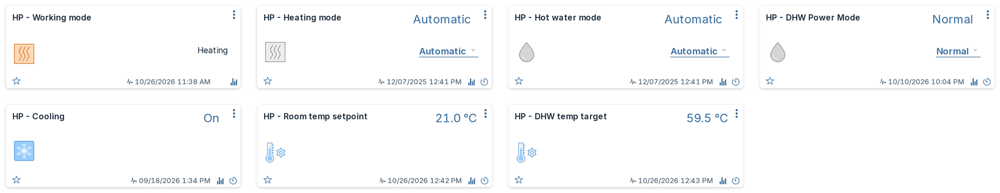
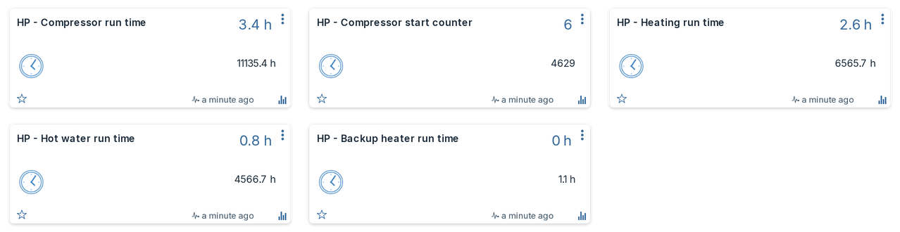
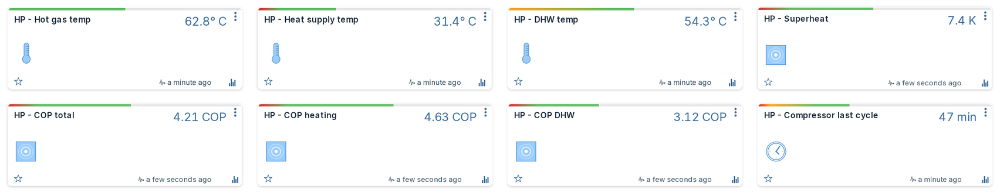

---
hide:
  - navigation
---

# Luxtronik Heat Pump Plugin for Domoticz

Monitor and control a Luxtronik heat pump from Domoticz, with efficiency numbers you can trust. The plugin reads the controller over your local network, creates devices for temperatures, power, heat output, COP, compressor and refrigerant data, and lets you change the heat pump's modes and setpoints from Domoticz.

[Install the plugin](install.md){ .md-button .md-button--primary }
[See all devices](devices.md){ .md-button }

## Does it work with my heat pump?

The plugin talks to **Luxtronik 2.0/2.1 based controllers**. Many manufacturers use them, among others Alpha Innotec, Siemens Novelan, Roth, Elco, Buderus, Nibe and Wolf Heiztechnik. It is developed and tested on an Alpha Innotec WZSV ground-source heat pump. Other models with a Luxtronik controller should work, but some devices may stay empty if your model has no matching sensor.

!!! info "Requirements"

    - Domoticz **2026.1 or newer**. The settings page uses named plugin settings, which older versions do not have. On an older Domoticz, stay on plugin version 2.2.0.
    - Python **3.11 or newer** (what Domoticz runs plugins with).
    - The heat pump controller reachable from Domoticz on your network, on port **8889** by default.
    - Nothing else to install: the plugin uses only Python's standard library.

## What you get

-   :material-gauge:{ .lg .middle } **COP you can trust**

    ---

    Separate COP for heating, hot water and combined, reported only while the compressor runs steadily. Start-up and idle periods no longer drag your averages down.

-   :material-pump:{ .lg .middle } **Pump power compensation**

    ---

    The controller only measures compressor power. Pick your WZSV model, or enter your own pump values, and the plugin adds the estimated circulation and brine pump power for a true system COP.

-   :material-thermometer-lines:{ .lg .middle } **Refrigerant diagnostics**

    ---

    Superheat, pressures, condensing temperature, refrigerant lift, discharge headroom and compression ratio: early signs of a circuit that is drifting.

-   :material-shield-check:{ .lg .middle } **Safe controls**

    ---

    Heating mode, hot water mode, cooling and setpoints can be changed from Domoticz. Every write is checked against a short list of allowed settings; anything else is blocked.

-   :material-tag-check:{ .lg .middle } **Your names stay yours**

    ---

    Device IDs are tied to the Domoticz hardware entry, so history survives restarts, IP changes and upgrades. A device you renamed is never renamed back, also not when you change the language.

-   :material-translate:{ .lg .middle } **Five languages**

    ---

    Device names, descriptions and selector options in English, Dutch, German, French and Polish, following the Domoticz interface language by default.

-   :material-home-group:{ .lg .middle } **More than one heat pump**

    ---

    Add one hardware entry per heat pump. Each gets its own independent set of devices.

-   :material-update:{ .lg .middle } **Update check**

    ---

    Once a day the plugin checks GitHub and announces a new release once, in the log and through your Domoticz notifications. It sends nothing about you or your heat pump, and you can turn it off.

## Screenshots

Device cards in Domoticz with the Machinon theme, with values from a real installation. The run-time cards show example values for one day.

=== "Power, heat and COP"

    

=== "Temperatures"

    

=== "Compressor and refrigerant"

    

=== "Controls"

    

=== "Run time"

    

=== "Health bars"

    

## Where to go next

- New here? Follow [Installation](install.md), then check [Settings](settings.md).
- Coming from the original Luxtronik plugin? See [Migrating from v1](migration.md) to bring your history along.
- A value looks wrong or a device is missing? Start at [Troubleshooting](faq.md).
